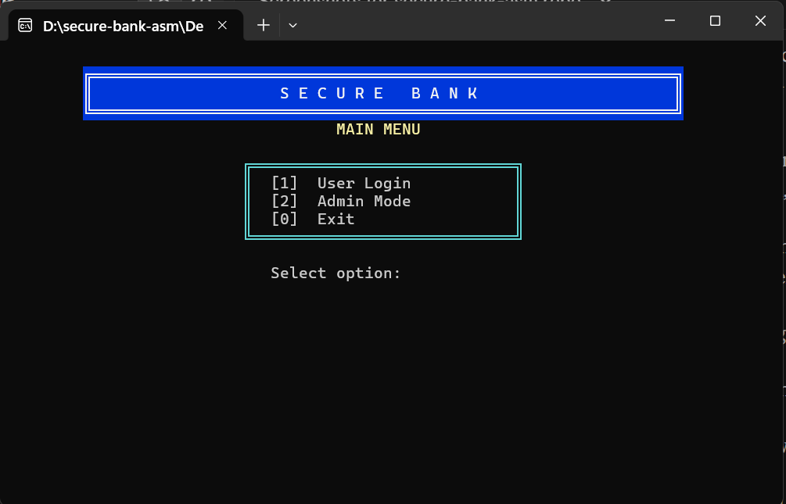

# Secure Bank: Mini ATM in x86 Assembly

A menu-driven ATM and banking system written in **32-bit x86 Assembly (MASM)** with the **Irvine32** library. It has hashed PINs, account locking, 64-bit balances, a transaction history kept in a 2D circular buffer, and data that is **saved to disk** between runs. All of it runs in a styled, colored console UI.

> COAL Lab Project, FAST-NUCES Karachi, Fall 2026

<!-- Replace with the real recording once the UI is finished -->


---

## Features

| | Feature | Highlights |
|---|---|---|
| 🔐 | **Secure login** | Masked `****` PIN entry. PINs are stored only as a **hash** (ROL/XOR/SHL), never in plain form. |
| 🚫 | **Account lock** | 3 wrong PINs lock the account (status bit set with `OR`, tested with `TEST`). |
| 💰 | **Deposit / Withdraw** | 64-bit balances using `ADD/ADC` and `SUB/SBB`, overflow and insufficient-balance checks. |
| 💵 | **Cash dispensing** | Note breakdown (5000 / 1000 / 500) computed with `DIV`. |
| 🔁 | **Fund transfer** | Between accounts, with self-transfer and locked-receiver checks. |
| 📈 | **Interest calculator** | Simple interest plus a year-by-year compound projection using `MUL` / `DIV`. |
| 🧾 | **Transaction history** | Last 10 transactions per account in a **2D circular buffer**. |
| 🔑 | **Change PIN** | Old PIN check, new PIN confirmed with `CMPSB`, buffers wiped with `STOSB`. |
| 🛠️ | **Admin panel** | Hashed admin password, table of all accounts, **unlock** locked accounts. |
| 💾 | **Persistent storage** | All data saved to `data/bank.dat` in one `WriteToFile` call and reloaded at startup. |
| 🎨 | **Console UI** | Box-drawing frames, color scheme, splash screen, loading bar, animated "Processing...". |

## Screenshots

| Main menu | Login | Admin panel |
|---|---|---|
|  |  |  |

## COAL concepts used

64-bit arithmetic (ADD/ADC, SUB/SBB) · MUL/DIV · shifts and rotates (SHL, ROL) ·
bit flags (AND/OR/TEST) · string instructions (MOVSB, CMPSB, STOSB, SCASB) ·
2D arrays · recursion with EBP stack frames · INVOKE/PROTO · Irvine32 file I/O

## Project structure

```
secure-bank-asm/
├── include/
│   └── bank_shared.inc              constants, colors, PROTOs, shared data declarations
├── src/
│   ├── core/
│   │   ├── main_menu.asm            entry point, main + user menus
│   │   ├── bank_records.asm         all account data (one saveable block)
│   │   ├── login_security.asm       PIN hashing, masked input, login, lock
│   │   ├── deposit_withdraw.asm     balance, deposit, withdraw, cash notes
│   │   └── number_input_output.asm  recursive 64-bit print, validated input
│   ├── ui/
│   │   └── console_ui.asm           boxes, colors, headers, splash, messages
│   └── services/
│       ├── transaction_history.asm  2D circular history buffer
│       ├── fund_transfer.asm        account-to-account transfer
│       ├── interest_calculator.asm  simple + compound interest
│       ├── change_pin.asm           PIN change with confirmation
│       ├── admin_panel.asm          account table, unlock
│       └── file_storage.asm         save / load bank.dat
├── data/                            bank.dat is created here at runtime
└── docs/                            test cases, screenshots
```

## How to build and run

**Requirements:** Windows, Visual Studio 2022 with the *Desktop development with C++* workload, and the [Irvine32 library](https://asmirvine.com/gettingStartedVS2022/index.htm) installed (usually in `C:\Irvine`).

1. Clone the repo, or download it with **Code → Download ZIP**.
2. Open `SecureBank.sln` in Visual Studio 2022.
3. Set the configuration to **Debug | x86** and press **Ctrl + F5**.

`SecureBank.vcxproj` looks for Irvine32 in `C:\Irvine` and `D:\CS\irvine`, and for `bank_shared.inc` in the `include` folder. If your Irvine32 is somewhere else, add your path in **Project → Properties → Microsoft Macro Assembler → General → Include Paths** and **Linker → General → Additional Library Directories**.

### Demo accounts

| Account | Name | PIN | Balance |
|---|---|---|---|
| 1001 | Ali Khan | 1234 | Rs. 50,000 |
| 1002 | Sara Ahmed | 4321 | Rs. 30,000 |
| 1003 | Usman Tariq | 1111 | Rs. 75,000 |
| 1004 | Hina Raza | 2580 | Rs. 1,200 *(locked; try unlocking it from admin)* |

Admin password: `admin123`. To reset everything, delete `data/bank.dat`.

## Known limitations

This is a learning project, not real banking software:
- The PIN hash is a simple custom function with no per-account salt, so two accounts with the same PIN have the same hash. Real systems use salted, slow hashes (bcrypt, Argon2).
- Amounts entered are limited to 32 bits (up to 4,294,967,295); balances are 64-bit.
- `data/bank.dat` is not encrypted, and is read relative to the working directory, so run the program from Visual Studio.

## Contributing

See [CONTRIBUTING.md](CONTRIBUTING.md) for the branch, pull request and review workflow the team follows.

## Team

| Member | Owns |
|---|---|
| **Ayousha** (Group Leader) | `include/`, `src/core/`, `src/ui/`: data, login and security, deposit/withdraw, number I/O, the whole console UI, integration |
| **Batool Zehra** | `src/services/`: transaction history, transfer, interest, change PIN, admin panel, file storage |

## Credits

- Kip R. Irvine, *Assembly Language for x86 Processors*, 8th ed., and the Irvine32 library
- Microsoft Macro Assembler (MASM) reference
